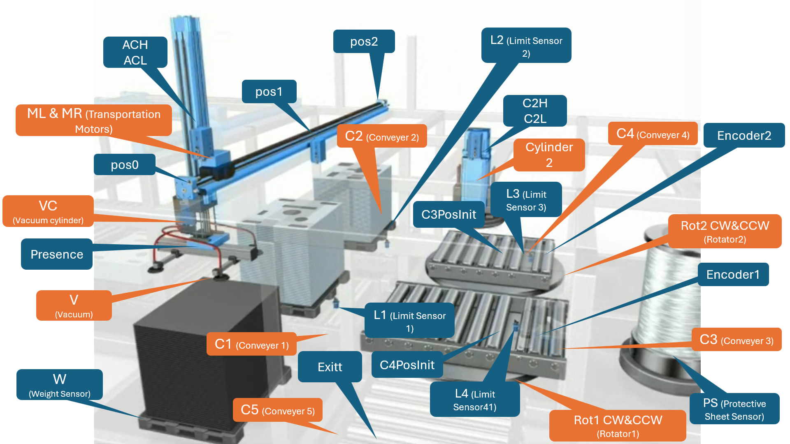

# Industrial Automation – Glass Packaging System

An industrial automation project designed to package glass assemblies by applying a thin metal sheet to the upper surface, using conveyor-based material handling, pneumatic actuation, vacuum gripping, and rotary path selection.

## Project Information

| Item | Details |
|:---|:---|
| Project | Industrial Automation – Glass Packaging System |
| Course/Lab | Industrial Automation Lab |
| Developers | Lawrence Abou Karroum and Ahmad Mansour |
| Simulation Software | Unity Pro|
| Control Programming | Schneider Electric – SFC |
| Submission Date | December 16, 2024 |

---

## Software and Technologies

The project was developed and simulated using the following software and automation technologies:

| Software / Technology | Purpose |
|:---|:---|
| Unity | Used to develop and simulate the industrial automation system. |
| Schneider Electric – Sequential Function Chart (SFC) | Used to implement the sequential control logic and coordinate the system's initialization and production operations. |

---

## Project Overview

This project was developed for the **Industrial Automation Lab** at the University of Balamand, Department of Mechatronics.

The system automates the handling and packaging of glass assemblies. A manipulator equipped with a vacuum cylinder picks up metal sheets and places them onto the assemblies. Conveyors transport the assemblies through the work area, while two encoder-equipped rotators allow the conveyor paths to be redirected.

### Main Objectives

- Apply a thin metal sheet to the top of a glass assembly.
- Coordinate the manipulator, vacuum mechanism, cylinders, conveyors, and rotators.
- Start normal production only when assemblies are detected at both required positions, `L1` and `L2`.
- Use encoder feedback to detect each 90° (quarter-turn) rotation of the rotators.
- Route packaged assemblies toward the exit conveyor.

---

## System Layout

The installation consists of:

- A linear manipulator driven by left and right transport motors.
- A double-acting vacuum cylinder used to position the manipulator.
- A vacuum outlet used to pick up and release metal sheets.
- Five conveyor sections.
- Two rotators carrying Conveyors 3 and 4.
- A double-acting support cylinder used while applying the protective sheet.
- Sensors for position, material presence, weight, cylinder position, conveyor position, and rotator angle.

The following image shows the system layout and the locations of its sensors and actuators.

---

## Production Concept

1. The system is initialized before normal production.
2. Normal production is permitted when an assembly is detected at `L1` and another assembly is detected at `L2`.
3. The manipulator uses the vacuum mechanism to pick up and handle a metal sheet.
4. The conveyor system transports assemblies through the work area.
5. Conveyors 3 and 4 are mounted on rotators. Encoder feedback is used to detect completed quarter-turns and support accurate path alignment.
6. The protection/exit operation is executed twice during the normal production sequence, as coordinated by the `ProtectionExit` synchronization SFC.

The detailed step-by-step PLC sequence and transition conditions are not included in this README. The descriptions below therefore cover the documented system behavior and control structure.

---

## Sensors and Inputs

| Symbol | Name | Function |
|:---|:---|:---|
| `pos0` | Position 0 | Detects whether the manipulator is at the far-left position. |
| `pos1` | Position 1 | Detects whether the manipulator is at the middle position. |
| `pos2` | Position 2 | Detects whether the manipulator is at the far-right position. |
| `Presence` | Presence sensor | Detects whether a metal sheet is attached to the manipulator by vacuum. |
| `W` | Weight sensor | Measures the weight of the metal sheet. A reading below the specified threshold `g` indicates that no sheets remain. |
| `VCH` | Vacuum Cylinder High | Detects whether the vacuum cylinder is in its high position. |
| `VCL` | Vacuum Cylinder Low | Detects whether the vacuum cylinder is in its low position. |
| `C2H` | Cylinder 2 High | Detects whether Cylinder 2 is in its high position. |
| `C2L` | Cylinder 2 Low | Detects whether Cylinder 2 is in its low position. |
| `Encoder1` | Rotator 1 encoder | Measures completed quarter-turns (90°) of Rotator 1. |
| `Encoder2` | Rotator 2 encoder | Measures completed quarter-turns (90°) of Rotator 2. |
| `PS` | Protective sheet sensor | Detects whether the protective sheet roll is not empty. |
| `L1` | Limit switch 1 | Detects when an assembly reaches the required position on Conveyor 1. |
| `L2` | Limit switch 2 | Detects when an assembly reaches the required position on Conveyor 2. |
| `L3` | Limit switch 3 | Detects when an assembly reaches the required position on Conveyor 3. |
| `L4` | Limit switch 4 | Detects when an assembly reaches the required position on Conveyor 4. |
| `C3PosInit` | Conveyor 3 initial-position sensor | Detects whether Conveyor 3 has returned to its initial position for normal production. |
| `C4PosInit` | Conveyor 4 initial-position sensor | Detects whether Conveyor 4 has returned to its initial position for normal production. |
| `Exitt` | Exit sensor | Detects when an assembly has left the work area. |

---

## Actuators and Outputs

| Symbol | Name | Function |
|:---|:---|:---|
| `VC` | Vacuum cylinder | Double-acting cylinder that controls the manipulator's vertical position. |
| `C1` | Conveyor 1 | Moves assemblies on the right side. |
| `C2` | Conveyor 2 | Moves assemblies on the left side. |
| `C3F` | Conveyor 3 forward | Moves assemblies toward Rotator 2 in the forward direction. |
| `C3B` | Conveyor 3 backward | Moves assemblies in the backward direction on Conveyor 3. |
| `C4F` | Conveyor 4 forward | Moves assemblies toward Rotator 1 in the forward direction. |
| `C4B` | Conveyor 4 backward | Moves assemblies in the backward direction on Conveyor 4. |
| `C5` | Conveyor 5 | Moves assemblies toward the exit. |
| `V` | Vacuum outlet | Generates vacuum to pick up metal sheets. |
| `MR` | Transport motor right | Moves the manipulator to the right. |
| `ML` | Transport motor left | Moves the manipulator to the left. |
| `Cylinder2` | Cylinder 2 | Double-acting cylinder that supports assemblies while the protective sheet is applied. |
| `Rot1CW` | Rotator 1 clockwise | Rotates Rotator 1 clockwise. |
| `Rot1CCW` | Rotator 1 counterclockwise | Rotates Rotator 1 counterclockwise. |
| `R2CW` | Rotator 2 clockwise | Rotates Rotator 2 clockwise. |
| `R2CCW` | Rotator 2 counterclockwise | Rotates Rotator 2 counterclockwise. |

---

## Operator Control Panel

### Inputs

| Control | Type | Description |
|:---|:---|:---|
| `Start` | Normally open (NO) push button | Starts the process. |
| `Init` | Normally open (NO) push button | Requests system initialization. |
| `Emergency` | Normally closed (NC) push button | Stops the process when an emergency condition occurs. |

### Indicators

| Indicator | Description |
|:---|:---|
| `Run Lamp` | Illuminated while the process is running. |
| `Empty Lamp` | Illuminated when material is empty (metal sheets or protective sheets). |
| `Stop Lamp` | Illuminated when an emergency condition is present. |
| `Init Lamp` | Illuminated when initialization has been completed. |

---

## Sequential Function Charts (SFCs)

Two synchronization SFCs were implemented to reuse common operations and coordinate the production sequence.

### 1. `CylinderMechanism`

**Purpose:** Controls the vacuum-cylinder and manipulator operations. It is used during initialization and normal production.

**Documented Usage:**

- Initialization: step `I5`.
- Normal production: steps `P3`, `P4`, `P5`, and `P6`.

**Responsibilities:**

- Extend the vacuum cylinder.
- Attach or detach a metal sheet using the vacuum mechanism.
- Move the manipulator left or right when required.
- Retract the vacuum cylinder.

**Initialization Exception:** During step `I5`, manipulator movement is not required.

### 2. `ProtectionExit`

**Purpose:** Coordinates the protective-sheet packaging operation and directs the assembly toward the exit path.

**Documented Usage:**

- Normal production: steps `P9` and `P14`.
- The operation is repeated twice during the production workflow.

---

## Important Operating Conditions

- Normal production requires assemblies to be detected at both `L1` and `L2`.
- Rotator alignment is monitored using `Encoder1` and `Encoder2`, with each encoder measuring 90° increments.
- The initial positions of Conveyors 3 and 4 are monitored by `C3PosInit` and `C4PosInit`.
- The metal-sheet supply is monitored by the weight sensor `W`.
- The protective-sheet supply is monitored by sensor `PS`.
- The `Empty Lamp` indicates an empty metal-sheet or protective-sheet supply.
- The emergency push button is normally closed and is used to stop the process during an emergency.

---
